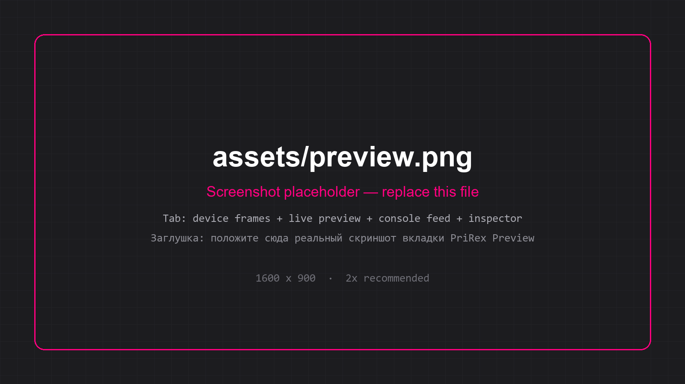
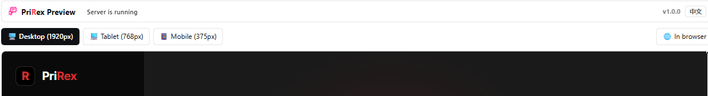
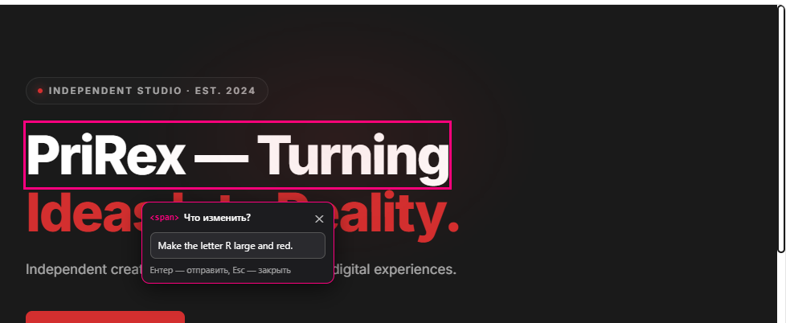
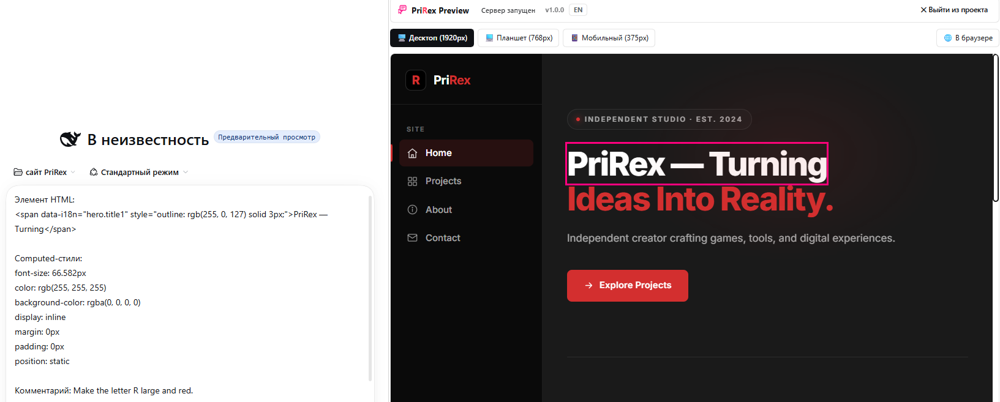
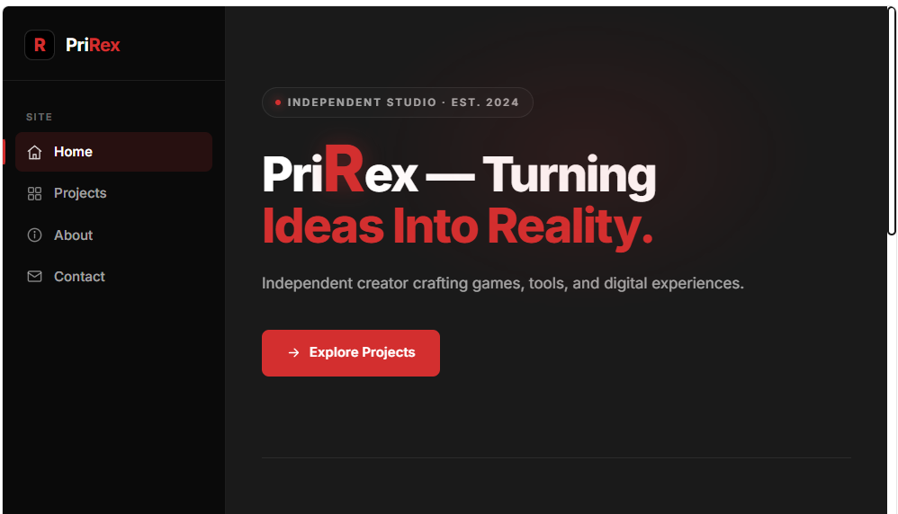

[English](#english) | [Русский](#русский)

<p align="center">
  
</p>

<h1 align="center">PriRex Preview</h1>

<p align="center"><em>Live preview · device frames · console error feed · point-and-ask DOM inspector — inside DeepSeek Harness.</em></p>

<p align="center">
  <a href="https://github.com/Prirex/PriRex-Preview"></a>
  <a href="https://github.com/Prirex/PriRex-Preview/releases"></a>
  <a href="https://github.com/Prirex/PriRex-Preview/blob/main/package.json"></a>
  <a href="LICENSE"></a>
</p>

<!-- НАЧАЛО СКРИНШОТА: Реальная вкладка PriRex Preview — сервер запущен, фреймы устройств, живой предпросмотр -->

<!-- КОНЕЦ СКРИНШОТА -->

## Screenshots · Скриншоты

| Device frames · Панель устройств | Point-and-ask inspector · Точечный инспектор |
|---|---|
|  |  |
| `Desktop (1920px)` / `Tablet (768px)` / `Mobile (375px)` switch the frame; the page is scaled to fit the sidebar, `In browser` opens the same URL outside DSH.<br>`Desktop (1920px)` / `Tablet (768px)` / `Mobile (375px)` переключают фрейм, страница масштабируется под ширину боковой панели, `In browser` открывает тот же адрес вне DSH. | Hover → countdown → freeze (pink outline) → «Что изменить?».<br>Наведение → обратный отсчёт → заморозка (розовый контур) → «Что изменить?». |

**From the inspector to the chat draft · Из инспектора в черновик чата**



`outerHTML` + computed styles + your comment are inserted into the active chat draft; **auto-submit is off**, so you review and press send yourself — in the screenshot the payload is already in the input, the tab stays live beside it.

`outerHTML` + вычисленные стили + ваш комментарий вставляются в черновик активного чата; **автоотправка выключена** — вы проверяете текст и отправляете сами. На скриншоте payload уже в поле ввода, а вкладка с живой страницей остаётся рядом.

**Result · Результат**



The loop closed: the agent edited the code and the page reloaded through live reload — the `R` in the headline is now red and large, exactly as asked in the panel.

Цикл замкнулся: агент поправил код, страница перезагрузилась через live reload — `R` в заголовке стала красной и крупной, ровно как просили в панели.

---

## English

### Overview

PriRex Preview is a local development companion for **DeepSeek Harness (DSH)**. It adds a
`PriRex Preview` tab to the right panel: pick a project folder, get it served over HTTP with
live reload, review it in desktop/tablet/mobile frames, watch console errors stream in, and
point at any element on the page to have its markup and computed CSS dropped straight into
your chat input.

Everything is **local by design**: the HTTP server and the WebSocket hub bind to `127.0.0.1`,
no telemetry is emitted, and nothing leaves your machine.

### Key Features

- **One-click live server** — serves the selected folder from an ephemeral localhost port with
  CORS enabled; `index.html` is picked automatically when present.
- **WebSocket live reload** — `chokidar` watches `*.html`, `*.htm`, `*.css`, `*.js` and pushes a
  `reload` signal to the embedded WebView (150 ms debounce, so save storms stay quiet).
- **Device frames** — 1920 px desktop, 768 px tablet, 375 px mobile, scaled to fit the sidebar.
- **Console error feed** — captures `window.onerror`, `unhandledrejection` and `console.error`
  from the previewed page, with source/line/column; one click copies a ready-to-paste report.
- **Point-and-ask DOM inspector** — hover an element for a configurable delay (1.5/3/5 s, default 3 s).
  A dashed outline fills into a solid one, the element freezes behind a 🔒 badge, and a
  *"What should change?"* panel opens. Your note plus `outerHTML` and computed styles are
  inserted into the active chat draft — **auto-submit is always off**, you review and send.
- **Freeze management** — press <kbd>R</kbd> (or <kbd>К</kbd>) to release all frozen elements.
- **Trilingual UI** — RU → EN → 中文 switcher, persisted locally, theme-token styling.
- **Project-aware** — HTML discovery is depth-limited (≤3), capped (≤500 files) and skips
  `node_modules`, `.git`, `dist`, `build`, `.next`.

### Installation

Requirements: DeepSeek Harness with the Web surface, Node.js ≥ 20.

```bash
# 1. Clone
git clone https://github.com/Prirex/PriRex-Preview.git
cd PriRex-Preview

# 2. Install dependencies (pnpm or npm — the lockfile is pnpm's)
pnpm install        # or: npm install
pnpm run build      # or: npm run build

# 3. Verify the browser artifact is a valid classic script
pnpm run smoke      # or: npm run smoke
```

Then register the plugin in DSH: **Plugins → Install bundle → local path** and point it at this
folder. The bundled [`cordis.patch.yml`](cordis.patch.yml) inserts the `prirexstudio` row
automatically, so no manual patch editing is required.

> `lib/` is committed on purpose — the compiled plugin works without a build step. Rebuild only
> after touching `index.ts` or `client.cts`.

### Quick Start

1. Create any static page, e.g. `index.html`:

   ```html
   <!doctype html>
   <html lang="en">
     <head><meta charset="utf-8"><title>Demo</title></head>
     <body>
       <h1 id="title">Hello, PriRex!</h1>
       <button onclick="console.error('boom from the page')">Break me</button>
     </body>
   </html>
   ```

2. Open the right panel → **PriRex Preview** tab → choose the folder → press **Run**.
3. Switch device width, then hover the `<h1>` for ~3 s: it freezes and the edit panel opens.
4. Type `make the title red and larger` → <kbd>Enter</kbd>. The inspector payload lands in your
   chat draft; send it and let the agent edit the code — the page reloads itself on save.
5. Click **Break me** to see the error arrive in the console feed.

The tab also auto-opens the current session's working directory on first connect when the server
is not running yet.

### Configuration

| Variable           | Default   | Description                                    |
| ------------------ | --------- | ---------------------------------------------- |
| `PRIREX_HUB_PORT`  | `3099`    | Port of the local WebSocket hub (`127.0.0.1`).  |

Per-user settings stored in `localStorage`:

| Key               | Values                              | Description                     |
| ----------------- | ----------------------------------- | ------------------------------- |
| `prirex.lang`     | `ru` \| `en` \| `zh`                | UI language.                    |
| `prirex.hoverMs`  | `1500` \| `3000` \| `5000`          | Hover delay before inspecting.  |

### Wire Protocol

Hub: `ws://127.0.0.1:3099`. Page side identifies itself with `hello`; the sidebar tab sends
control messages.

| Direction        | Message                                                            |
| ---------------- | ------------------------------------------------------------------ |
| tab → host       | `{type:'hello', sessionId}` · `{type:'start', dir, file}` · `{type:'stop'}` · `{type:'status'}` · `{type:'hover-ms', ms}` |
| host → tab       | `{type:'status', running, port, dir, file, files}` · `{type:'stopped'}` · `{type:'started-error', error}` |
| host → page      | `{type:'reload', file}` · `{type:'hover-ms', ms}`                   |
| page → host → tab| `{type:'console-error', level, message, source, line, col}` · `{type:'inspector-prompt', comment, html, styles}` |

### Project Layout

```text
PriRex-Preview/
├─ index.ts               # host service: WS hub, HTTP server, file watcher, HTML injection
├─ client.cts             # browser artifact source: right-panel tab (React via DSH module table)
├─ logo-data.ts           # inlined brand logo for the client bundle
├─ cordis.patch.yml       # DSH bundle patch that registers the plugin row
├─ locale/{ru,en}.json    # plugin metadata strings
├─ scripts/               # finalize-client.mjs, smoke-client.mjs, test-hub.mjs
├─ types/                 # ambient typings
├─ lib/                   # committed build output: index.js, client.js (browser classic script)
└─ icon.svg               # plugin icon
```

### Development

```bash
npm run build      # tsc → lib/, then rewrite lib/client.cjs into a browser classic script
npm run smoke      # execute lib/client.js in a bare VM (no exports/module/require)
npm run test:hub   # end-to-end host protocol test (temp project, HTTP fetch, start/stop)
npm run check      # build + smoke
```

`client.cts` is compiled to CJS and then rewritten by [`scripts/finalize-client.mjs`](scripts/finalize-client.mjs)
into an IIFE, because DSH evaluates client entries as classic scripts.

### Security

Local-only tool: both servers bind to `127.0.0.1`, static serving is path-traversal guarded, and
the inspector never auto-sends messages. Found a problem? See [SECURITY.md](SECURITY.md) —
please report privately, never in a public issue.

### Publishing to npm (optional)

`package.json` sets `"private": true` to prevent accidental publishes. The package is named
`dsh-prirex-preview`; to ship it through npm, flip that flag and — if you need a different name or
scope — update `name` in `package.json`, `cordis.patch.yml` and the `id` in
[`client.cts`](client.cts) **together**, because the client registers itself in the DSH module table
under the package name.

### Changelog / What's new

#### v1.0.0 — first public release

- Host service: WebSocket hub on `127.0.0.1:3099`, ephemeral HTTP preview server, `chokidar`
  live reload, HTML discovery with depth/file caps, session working-directory auto-open.
- Client tab: device frames (1920/768/375), console error journal with AI-ready copy,
  point-and-ask DOM inspector with freeze/countdown mechanics, RU/EN/中文 UI.
- Tooling: reproducible build (`tsc` + client finalizer), VM smoke test, end-to-end hub test.

### License

[MIT](LICENSE) © 2026 [Prirex](https://github.com/Prirex)

---

## Русский

### Описание

PriRex Preview — локальный инструмент разработки для **DeepSeek Harness (DSH)**. Он добавляет
вкладку `PriRex Preview` в правую панель: выбираете папку проекта — получаете локальный
HTTP-сервер с живой перезагрузкой, фреймы «десктоп / планшет / мобильный», журнал ошибок
консоли со страницы и DOM-инспектор, который по наведению на элемент вставляет его разметку
и вычисленные CSS-стили прямо в поле ввода чата.

Всё работает **только локально**: HTTP-сервер и WebSocket-хаб слушают `127.0.0.1`, телеметрии
нет, данные не покидают машину.

### Ключевые возможности

- **Сервер в один клик** — выбранная папка раздаётся на свободном порту localhost с открытым
  CORS; `index.html` подхватывается автоматически.
- **Live-reload по WebSocket** — `chokidar` следит за `*.html`, `*.htm`, `*.css`, `*.js` и шлёт
  сигнал `reload` во встроенный WebView (дебаунс 150 мс, чтобы серии сохранений не спамили).
- **Панель устройств** — 1920 px десктоп, 768 px планшет, 375 px мобильный, с подгонкой под
  ширину боковой панели.
- **Журнал ошибок консоли** — перехват `window.onerror`, `unhandledrejection` и `console.error`
  просматриваемой страницы с файлом, строкой и колонкой; копирование готового отчёта в один клик.
- **Точечный DOM-инспектор** — наводите курсор на элемент, ждёте настраиваемую задержку
  (1,5 / 3 / 5 с, по умолчанию 3 с). Пунктирный контур «дорисовывается» в сплошной, элемент
  замораживается под бейджем 🔒 и открывается панель «Что изменить?». Ваша заметка вместе с
  `outerHTML` и вычисленными стилями попадает в черновик активного чата — **автоотправка всегда
  выключена**, отправляете вы сами.
- **Управление заморозкой** — <kbd>R</kbd> (или <kbd>К</kbd>) снимает все замороженные элементы.
- **Три языка интерфейса** — переключатель RU → EN → 中文 с сохранением выбора, оформление на
  токенах темы DSH.
- **Умный обход проекта** — поиск HTML ограничен глубиной (≤3) и количеством (≤500 файлов),
  каталоги `node_modules`, `.git`, `dist`, `build`, `.next` пропускаются.

### Установка

Требования: DeepSeek Harness с веб-интерфейсом, Node.js ≥ 20.

```bash
# 1. Клонирование
git clone https://github.com/Prirex/PriRex-Preview.git
cd PriRex-Preview

# 2. Зависимости и сборка хоста + браузерного артефакта
pnpm install        # или: npm install
pnpm run build      # или: npm run build

# 3. Проверка, что браузерный артефакт — валидный классический скрипт
pnpm run smoke      # или: npm run smoke
```

Затем зарегистрируйте плагин в DSH: **Плагины → Установить бандл → локальный путь** и укажите эту
папку. Входящий в комплект [`cordis.patch.yml`](cordis.patch.yml) сам вставляет строку
`prirexstudio` — править патч вручную не нужно.

> Каталог `lib/` закоммичен намеренно: собранный плагин работает без шага сборки. Пересобирайте
> только после правок `index.ts` или `client.cts`.

### Быстрый старт

1. Создайте любую статическую страницу, например `index.html`:

   ```html
   <!doctype html>
   <html lang="ru">
     <head><meta charset="utf-8"><title>Демо</title></head>
     <body>
       <h1 id="title">Привет, PriRex!</h1>
       <button onclick="console.error('ошибка со страницы')">Сломай меня</button>
     </body>
   </html>
   ```

2. Откройте правую панель → вкладку **PriRex Preview** → выберите папку → нажмите **Запустить**.
3. Переключите ширину устройства и наведите курсор на `<h1>` на ~3 с: элемент заморозится и
   откроется панель правки.
4. Напишите «сделай заголовок красным и крупнее» → <kbd>Enter</kbd>. Данные инспектора окажутся
   в черновике чата: отправьте их, и агент поправит код — страница перезагрузится сама.
5. Нажмите «Сломай меня», чтобы увидеть ошибку в журнале консоли.

Если сервер ещё не запущен, вкладка при первом подключении сама открывает рабочую папку текущей
сессии.

### Настройки

| Переменная        | По умолчанию | Назначение                                        |
| ----------------- | ------------ | ------------------------------------------------- |
| `PRIREX_HUB_PORT` | `3099`       | Порт локального WebSocket-хаба (`127.0.0.1`).      |

Пользовательские настройки в `localStorage`:

| Ключ             | Значения                            | Назначение                        |
| ---------------- | ----------------------------------- | --------------------------------- |
| `prirex.lang`    | `ru` \| `en` \| `zh`                | Язык интерфейса.                  |
| `prirex.hoverMs` | `1500` \| `3000` \| `5000`          | Задержка наведения до инспектора. |

### Структура проекта

```text
PriRex-Preview/
├─ index.ts               # хост-сервис: WS-хаб, HTTP-сервер, watcher, инъекция в HTML
├─ client.cts             # исходник браузерной части: вкладка правой панели (React из таблицы DSH)
├─ logo-data.ts           # инлайн-логотип для клиентского бандла
├─ cordis.patch.yml       # патч бандла DSH, регистрирующий строку плагина
├─ locale/{ru,en}.json    # строки метаданных плагина
├─ scripts/               # finalize-client.mjs, smoke-client.mjs, test-hub.mjs
├─ types/                 # ambient-типизация
├─ lib/                   # закоммиченный результат сборки: index.js, client.js (классический скрипт)
└─ icon.svg               # иконка плагина
```

### Разработка

```bash
npm run build      # tsc → lib/, затем перепаковка lib/client.cjs в браузерный классический скрипт
npm run smoke      # запуск lib/client.js в чистой VM (без exports/module/require)
npm run test:hub   # сквозной тест протокола хоста (временный проект, HTTP-запрос, start/stop)
npm run check      # build + smoke
```

`client.cts` компилируется в CJS, а затем [`scripts/finalize-client.mjs`](scripts/finalize-client.mjs)
оборачивает результат в IIFE: DSH исполняет клиентские записи как классические скрипты.

### Безопасность

Инструмент строго локальный: оба сервера слушают `127.0.0.1`, раздача файлов защищена от
path traversal, инспектор никогда не отправляет сообщения сам. Нашли проблему — см.
[SECURITY.md](SECURITY.md), сообщайте приватно, не через публичный issue.

### Публикация в npm (опционально)

В `package.json` стоит `"private": true`, чтобы исключить случайную публикацию. Пакет называется
`dsh-prirex-preview`; для раздачи через npm снимите этот флаг, а если нужно другое имя или скоуп —
меняйте `name` в `package.json`, `cordis.patch.yml` и `id` в [`client.cts`](client.cts)
**одновременно**: клиент регистрирует себя в таблице модулей DSH под именем пакета.

### Что нового

#### v1.0.0 — первый публичный релиз


### Лицензия

[MIT](LICENSE) © 2026 [Prirex](https://github.com/Prirex)
